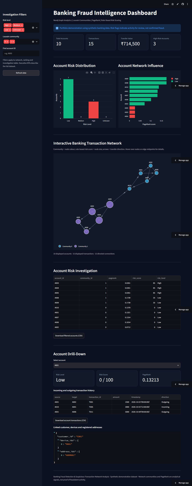

# Banking Fraud Intelligence Dashboard

**Graph-based transaction monitoring and suspicious-activity exploration using Neo4j AuraDB, Python, NetworkX, Plotly and Streamlit.**

> **Portfolio proof of concept:** This application uses a small, synthetic banking dataset. Its risk flags are illustrative investigation signals, **not verified fraud findings or fraud probabilities**.

<!-- Replace the placeholders below with your actual deployed app and repository links. -->
**Live dashboard:** [Open the Streamlit application]([YOUR_STREAMLIT_APP_URL](https://banking-fraud-intelligence-dashboardvisual.streamlit.app/))  

<!-- Optional: upload a screenshot to assets/dashboard-overview.png and uncomment. -->
<!--  -->

## Executive summary

Banks need to understand not only individual transactions but also **relationships between accounts**. This project demonstrates a graph-first workflow for exploring transfers, account connectivity, shared customer attributes and potentially suspicious patterns. Neo4j stores the network; Python and NetworkX calculate network analytics; Streamlit and Plotly present an interactive investigation interface.

The dashboard helps an analyst answer questions such as:

- Which accounts have the highest rule-based risk scores?
- Which accounts exchange funds, and in which direction?
- Are there connected groups of accounts that warrant further review?
- Which accounts are structurally influential according to PageRank?
- What transaction history, devices and registered addresses are linked to a selected account?

## Application features

| Area | Capability | Analyst value |
| --- | --- | --- |
| Executive overview | Total accounts, transaction count, aggregate transfer value and high-risk account count | Understand the scope of the demonstration dataset |
| Risk distribution | Interactive Plotly bar chart by risk category | Compare Low, Medium, High and Unknown classifications |
| Network influence | PageRank ranking | Identify accounts with relatively high network influence |
| Transaction network | Directed account-to-account graph with arrowheads | Trace the direction of transfers |
| Community exploration | Nodes coloured by previously computed Louvain community ID | Explore clusters of connected accounts |
| Investigation filters | Risk level, community and account-ID search | Narrow the investigation to relevant accounts |
| Account drill-down | Risk score, PageRank, incoming/outgoing transactions | Inspect a selected account in context |
| Linked customer context | Customer ID, device IDs and registered address IDs | Review potentially shared identifiers |
| Exports | Download filtered accounts and account transaction history as CSV | Support further analysis and reporting |
| Data refresh | Refresh cached Neo4j query results | Retrieve updated database records |

**Filter behaviour:** The executive KPI cards and risk-distribution chart describe the full dataset. The network, PageRank ranking and account investigation table respond to the sidebar filters. A transfer is shown in the filtered network only when **both** accounts are included in the selection. The account drill-down shows the selected account's incoming and outgoing transfers from the full transaction dataset.

## Technology stack

| Layer | Technology | Role |
| --- | --- | --- |
| Graph database | Neo4j AuraDB | Stores accounts, customers, transactions and relationships |
| Query language | Cypher | Retrieves graph entities and relationships |
| Data processing | Python, pandas | Prepares account and transaction data |
| Graph analytics | NetworkX | Used in the analysis workflow for community detection and PageRank; positions dashboard network nodes |
| Visual analytics | Plotly | Interactive charts, network nodes and transaction connections |
| Web application | Streamlit | Dashboard, filtering, drill-down and CSV downloads |
| Hosting | Streamlit Community Cloud | Hosts the deployed web application |
| Version control | GitHub | Tracks application source and documentation |

## Data model

The demonstration graph contains the following node labels:

| Node label | Meaning |
| --- | --- |
| `Customer` | Synthetic banking customer |
| `Account` | Bank account owned by a customer |
| `Transaction` | Individual transfer record |
| `Device` | Device associated with a customer |
| `Address` | Registered customer address |
| `Merchant` | Merchant entity retained in the demonstration graph |

The key relationships are:

```cypher
(:Customer)-[:OWNS]->(:Account)
(:Customer)-[:USES]->(:Device)
(:Customer)-[:REGISTERED_AT]->(:Address)
(:Account)-[:INITIATED]->(:Transaction)
(:Transaction)-[:SENT_TO]->(:Account)
(:Account)-[:TRANSFERRED_TO]->(:Account)
(:Customer)-[:SHARED_DEVICE_WITH]->(:Customer)
(:Customer)-[:SHARED_ADDRESS_WITH]->(:Customer)
```

The dashboard reads **transaction records** via `Account → INITIATED → Transaction → SENT_TO → Account`. It does not rely on `TRANSFERRED_TO` for its transaction totals, helping avoid double-counting the two representations of the same transfer. The `Merchant` nodes are present in the graph but are not currently used by the dashboard.

### Demonstration dataset

The initial synthetic dataset used in this project contains:

| Measure | Count |
| --- | ---: |
| Customers | 10 |
| Accounts | 10 |
| Transactions | 15 |
| Devices | 7 |
| Addresses | 7 |
| Merchants | 5 |
| **Total nodes** | **54** |
| **Total relationships** | **83** |

These counts describe the **initial project dataset**, not a guaranteed live count. If the Neo4j data is expanded or modified, the live dashboard values may differ.

## Analytical approach

### 1. Graph modelling

Accounts, transfers and customer context are modelled as connected entities rather than independent rows. This makes it possible to inspect transfer paths and shared attributes through graph traversals.

### 2. Community detection

The project analysis workflow applies **Louvain community detection** to an undirected representation of the account-transfer network. The resulting `community_id` is written back to each `Account` node in Neo4j. The Streamlit dashboard **reads** this property; it does not recompute Louvain communities on every page load.

A community indicates graph structure. **Community membership alone does not imply collusion or fraud.**

### 3. PageRank

PageRank is calculated in the Python analysis workflow and stored as `Account.pagerank`. The dashboard uses it to rank accounts by network influence. PageRank is **not** a fraud likelihood estimate.

### 4. Enhanced rule-based risk scoring

The earlier analysis workflow assigned illustrative scores based on the following conditions:

| Indicator | Illustrative points |
| --- | ---: |
| Device shared with at least two other customers | 25 |
| Address shared with at least two other customers | 15 |
| At least one outgoing transaction of ₹50,000 or more | 20 |
| Participation in a rapid three-account transfer cycle | 25 |
| PageRank above the dataset's 80th percentile | 15 |
| **Maximum possible score** | **100** |

Illustrative classifications: **Low = 0–39**, **Medium = 40–69**, **High = 70–100**. These weights and thresholds were chosen for demonstration, not learned from labelled fraud outcomes or validated against a production banking dataset.

The deployed application reads `enhanced_risk_score` and `enhanced_risk_level` when present, and falls back to the earlier `risk_score` and `risk_level` properties if needed. **Scoring is performed upstream; the dashboard is primarily a visualisation and investigation layer.**

## Project structure

```text
banking-fraud-intelligence/
├── app.py                 # Streamlit dashboard and Neo4j queries
├── requirements.txt       # Python dependencies
├── README.md              # Project documentation
├── .gitignore             # Excludes secrets and local files
└── assets/                # Optional screenshots for the README
    └── dashboard-overview.png
```

The `assets/` directory is optional. Create it when you have a screenshot to publish.

## Run locally

**Prerequisites:** Python 3.10+ and access to a running Neo4j AuraDB instance populated with the expected graph schema and analytics properties.

1. Clone the repository and enter its directory:

   ```bash
   git clone YOUR_GITHUB_REPOSITORY_URL
   cd banking-fraud-intelligence
   ```

2. Create and activate a virtual environment:

   ```bash
   python -m venv .venv
   # Windows PowerShell:
   .venv\Scripts\Activate.ps1
   # macOS / Linux:
   # source .venv/bin/activate
   ```

3. Install dependencies:

   ```bash
   pip install -r requirements.txt
   ```

4. Create `.streamlit/secrets.toml` **locally** with the following keys:

   ```toml
   NEO4J_URI = "neo4j+s://YOUR_INSTANCE.databases.neo4j.io"
   NEO4J_USERNAME = "neo4j"
   NEO4J_PASSWORD = "YOUR_DATABASE_PASSWORD"
   ```

5. Launch the dashboard:

   ```bash
   streamlit run app.py
   ```

The Neo4j Python driver connects using the AuraDB **default database**. The code intentionally uses `driver.session()` without hard-coding `database="neo4j"`, because the database name may differ between Aura instances.

### `requirements.txt`

```text
streamlit
neo4j
pandas
plotly
networkx
numpy
```

### `.gitignore`

```gitignore
.streamlit/secrets.toml
.env
.env.*
.venv/
__pycache__/
*.pyc
.ipynb_checkpoints/
```

## Deploy with Streamlit Community Cloud

1. Push `app.py`, `requirements.txt` and `README.md` to GitHub.
2. Create an application in Streamlit Community Cloud and select the repository, branch and `app.py` entry point.
3. In the application's **Secrets** settings, add `NEO4J_URI`, `NEO4J_USERNAME` and `NEO4J_PASSWORD`.
4. Deploy, open the public app and verify that Neo4j queries return account and transaction data.
5. Add the real Streamlit URL to the **Live dashboard** link at the top of this README.

**Security:** Never commit `.streamlit/secrets.toml`, API keys, database passwords or real customer data. If a secret is accidentally committed, rotate it immediately and remove it from repository history. A public demonstration app should use synthetic or otherwise appropriately authorised data and read-only database credentials where supported.

## Example investigation workflow

1. Review the executive KPI cards and account risk distribution.
2. Filter to **High** risk accounts or select a Louvain community.
3. Explore the directed transaction network and hover over a connection to see aggregated transfer value and transaction count.
4. Select an account in **Account Drill-Down** to review its risk score, PageRank and transaction history.
5. Review its linked device and registered-address IDs as additional context.
6. Export the relevant CSV data for further review.

### Illustrative suspicious pattern

The synthetic dataset includes a rapid circular transfer pattern:

```text
A003 ──₹95,000──▶ A004
  ▲                 │
  │                 │ ₹92,000
  │                 ▼
  └────₹90,000──── A005
```

The demonstration timestamps place these transfers within a short interval. Such a pattern may merit investigation, but **a circular path is not proof of illicit activity**.

## Limitations and responsible use

- **Synthetic, very small sample:** Ten accounts and fifteen transfers cannot establish realistic model performance or operational scalability.
- **No validated detection accuracy:** Precision, recall, false-positive rate and ROC-AUC have not been established from labelled outcomes.
- **Heuristic risk weights:** Thresholds and points are illustrative, and should not be interpreted as calibrated probabilities.
- **Community and centrality are contextual signals:** Neither Louvain membership nor PageRank demonstrates fraudulent intent.
- **No live transaction ingestion:** The dashboard queries the stored graph and caches results for up to five minutes unless refreshed.
- **No production case-management workflow:** The application does not provide analyst approvals, audit trails, alert queues or regulatory reporting.
- **Graph-layout constraints:** A spring layout is useful for a small demo but may become crowded on large networks.

This project is an **analytics portfolio demonstration**, not a banking compliance system or a tool for making automated adverse decisions about customers.

## Future development

- Generate a larger, more realistic synthetic dataset with documented normal and suspicious scenarios.
- Add transaction timelines, velocity indicators, repeated beneficiary patterns and temporal graph features.
- Build a case-management view with investigation notes and review status.
- Introduce labelled synthetic outcomes and evaluate detection metrics, including false positives.
- Add role-based access, database least-privilege permissions, observability and deployment tests.
- Improve performance for large graphs with server-side filtering and scalable network visualisation.

## Project status

**Current:** Interactive Streamlit proof of concept hosted with Neo4j AuraDB, account-risk exploration, community and PageRank visualisations, directed transfer network, account drill-down and CSV exports.

**Next milestone:** Expand and evaluate the synthetic dataset before making claims about fraud-detection effectiveness.

---

**Disclaimer:** All example account identifiers, transactions and customer links are synthetic. Any suspicious-activity designation is a rule-based flag for analytical review and should not be treated as a finding of fraud.
